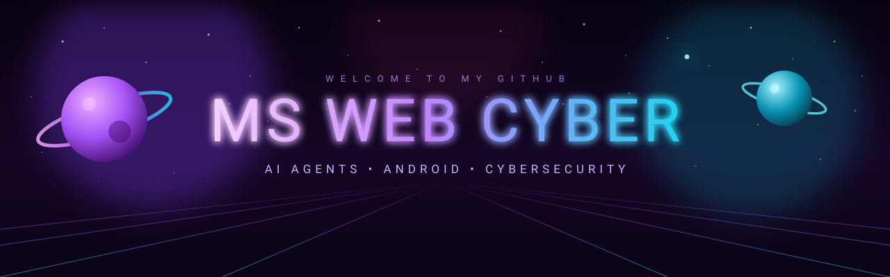

  

  
  
  

  

## About Me 🚀

- 🔭 Currently working on **Sitara** — an AI coding workspace for Android
- 🤖 Deep into **AI agents, automation & MCP servers**
- 🛡️ Exploring **cybersecurity, OSINT & ethical hacking**
- 📱 Mobile-first developer — **Android + Termux** is my daily setup
- 🌱 Learning **LLMs, on-device AI & security research**
- 💬 Ask me about **Android, Termux, Python, Git & AI tooling**
- ⚡ Fun fact: I build and ship straight from my phone

 

## Tech Stack 🛠️

  
  
  
  
  
  
  
  
  
  
  

## GitHub Stats 📊

  
  

  

  

  

## Featured Repos 📌

- [**New-Sitara-Agent**](https://github.com/Ms-web-cyber/New-Sitara-Agent) — an AI coding workspace for Android: terminal, editor, browser control and coding agents in one app
- [**KUMO-Domain-Recon-Tool**](https://github.com/Ms-web-cyber/KUMO-Domain-Recon-Tool) — domain OSINT & web security reconnaissance framework with 29 parallel modules
- [**stickman-video-director**](https://github.com/Ms-web-cyber/stickman-video-director) — turn any script into viral, multi-style animated stickman videos

## Connect with me 🤝

  
  

  

